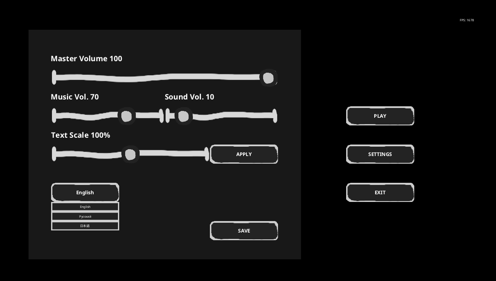
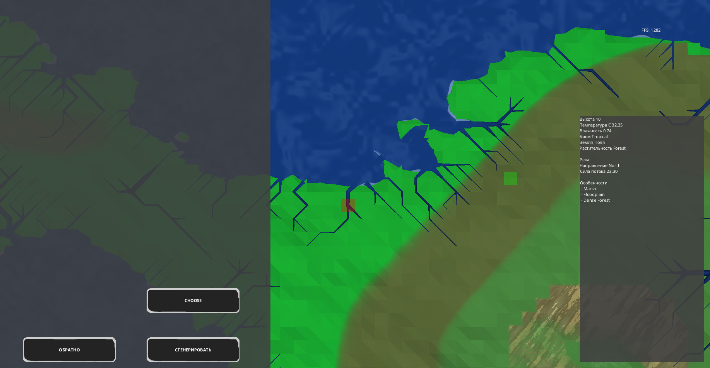

# Voxel World

A C++ real-time 3D voxel world project built with SDL3, bgfx and Vulkan.

The project combines a custom rendering layer, UI system, procedural world generation and asynchronous voxel chunk processing. It is primarily a personal C++ project focused on real-time rendering, multithreading, procedural generation and engine architecture.






## Features

- Real-time 3D rendering using bgfx with Vulkan
- Procedural 2D world generation
  - Height maps
  - Biomes
  - Climate simulation
  - Air-flow simulation
- 3D voxel world generation
  - 32×32×32 voxel chunks
  - Dynamic chunk loading around the camera
  - Asynchronous chunk generation and meshing
  - Sunlight propagation
  - Voxel raycasting
  - Frustum culling
- Custom UI system
  - Hierarchical widget tree
  - Buttons, text, sliders, text boxes, scroll containers and dropdowns
  - Grid-based layout
  - Anchoring
  - Signals/events
  - UI animations and tweens
- Internationalization
  - English
  - Russian
  - Japanese
  - CJK font support
  - Runtime language switching
- Audio system
  - Master volume
  - Music volume
  - Sound effects volume
- Settings serialization
- Data-driven blocks, materials and world definitions
- Resource and asset management
- Multithreaded task processing using a thread pool
- Tracy profiling integration
- CMake-based build system

## Technology Stack

- **C++**
- **CMake**
- **SDL3** — windowing, input and platform integration
- **bgfx** — rendering abstraction
- **Vulkan** — graphics backend
- **EnTT** — entity/component utilities
- **fmt** — formatting
- **nlohmann/json** — JSON serialization and configuration
- **miniaudio** — audio playback
- **stb** — image and font processing
- **BS::thread_pool** — multithreaded task processing
- **Tracy** — profiling

## Project Structure

```text
src/
├── app/          Application entry point
├── audio/        Audio system
├── engine/       Core engine systems
│   ├── animation/
│   ├── audio/
│   ├── core/
│   ├── generation/
│   ├── render/
│   ├── serialization/
│   └── utils/
├── game/         Game-specific systems
│   ├── components/
│   ├── items/
│   ├── states/
│   └── world/
├── i18n/         Internationalization
├── platform/     Platform and window management
├── render/       Rendering implementation
└── ui/           Custom UI system
```

The game/world module contains the main voxel world implementation, including chunks, world generation, chunk meshing, streaming, raycasting and lighting.

Assets and game data are stored separately from the source code:

```text
assets/
├── audio/
├── data/
├── fonts/
├── i18n/
├── materials/
├── shaders/
└── textures/
```

# Dependencies

The project includes `stb` with a local CMake wrapper. Download the other
third-party source dependencies with Python 3.12 or newer (no Python packages
or Git installation required):

```bash
python3 download_dependencies.py
```

The script installs the pinned versions below into `external/`. It can also be
invoked from another working directory using the path to the script. Internet
access to GitHub is required for downloads; subsequent builds use local sources.

Existing dependency directories are checked for required files and skipped,
without verifying their versions or overwriting local changes. To download a
dependency again, remove its directory explicitly and rerun the script. Failed
or interrupted downloads are cleaned up; rerun to continue with missing libraries.
The bundled `stb` directory is never downloaded or modified.

Expected source layout:

```text
external/
├── bgfx.cmake-1.143-9241-532
├── entt-3.16.0
├── fmt-12.1.0
├── json-3.12.0
├── miniaudio-0.11.25
├── SDL3-3.4.8
├── stb
├── thread-pool-5.1.0
├── tracy-eb3df3b-0.13.1
└── zstd-1.5.7
```

The exact versions used by the project are listed above.

Downloaded dependencies are kept out of version control to limit repository
size. The downloader uses fixed upstream revisions, including Tracy commit
`eb3df3b411438bbe0ae0e3d989427a14019d3270` and the bgfx source release containing
its matching `bgfx`, `bx`, and `bimg` sources. Upstream license files remain in
the downloaded source trees.

# Building

Install CMake 3.20+, a C++20 compiler, Intl/Gettext, and the platform development
libraries required by SDL3 and bgfx. After downloading dependencies, configure
and build from the repository root:

```bash
cmake -S . -B build -DCMAKE_BUILD_TYPE=Debug
cmake --build build --parallel
```

Run `./build/src/app/app` from the repository root so relative asset paths resolve.

The project is currently developed and built using Visual Studio Code with the CMake Tools extension.

After running the dependency downloader, open the project in VS Code and configure it using the CMake Tools extension. Select the desired CMake build configuration and build the project from the CMake Tools interface (build was tested on recent versions of GCC and Clang).

# Controls

The current gameplay camera uses:

* `W` / `A` / `S` / `D` — camera movement
* `Shift` — move faster
* `Right mouse button` — rotate camera
* `Mouse wheel` — zoom
* `Ctrl` + `mouse wheel` — adjust camera height

# Development Status

This is an ongoing personal project. The current implementation focuses on the underlying engine and world-generation systems rather than on a complete game experience.

Major areas currently implemented include rendering, procedural world generation, voxel chunk management, asynchronous processing, UI, audio, localization and basic gameplay state management.
